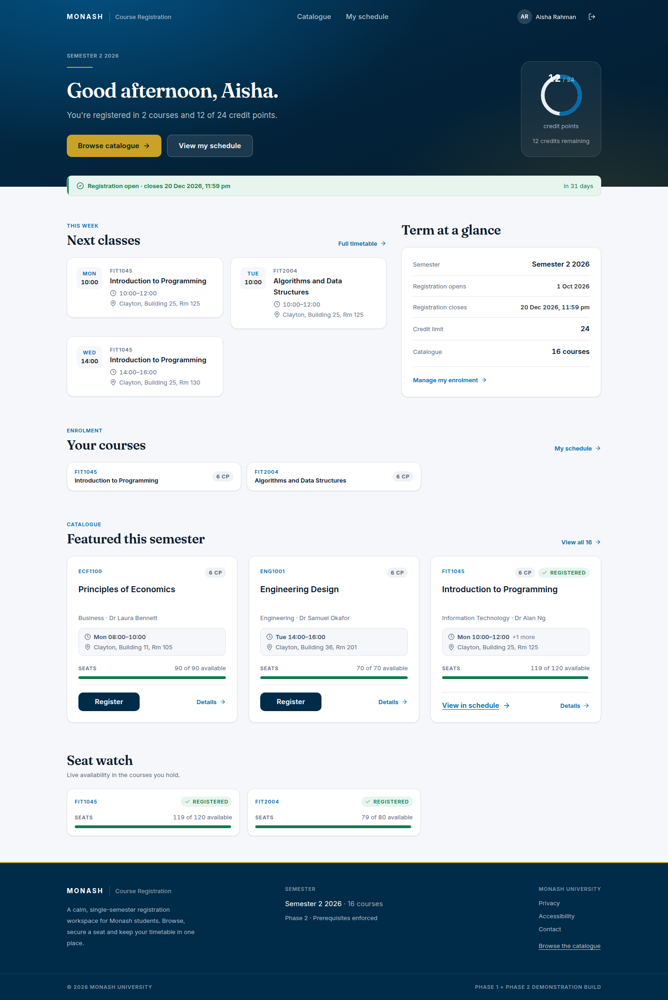
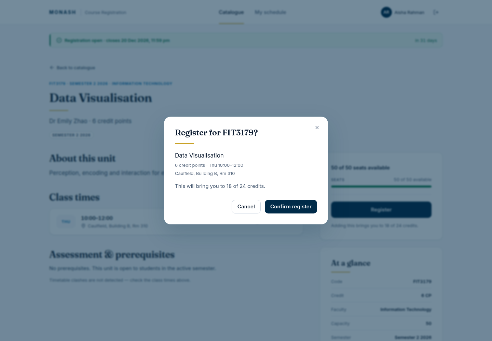
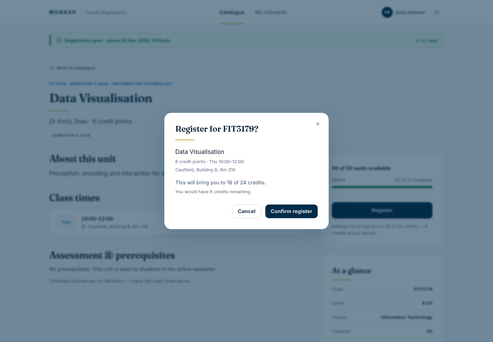
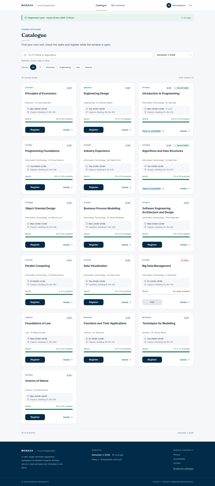
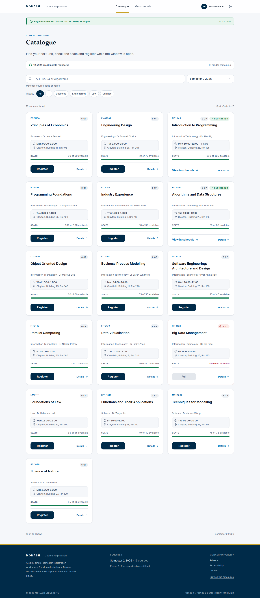

# FR10 maximum credit-hour validation — visual evidence

Captured from the running application (Spring Boot + Vite dev server, H2 seed) at a 1440 × 1000
viewport, light theme, registration window open. Both revisions use the same seeded student
Aisha Rahman (`32012345`), who has no registrations at startup.

- **Before / baseline:** `a486cde` (`main`), where the credit limit is the hardcoded `24` and the
  register dialog has no remaining-credit line.
- **After:** the FR10 implementation on this branch. `04`–`06` run with the default limit (`24`) so
  the before/after layout is comparable. `07`–`10` run with `REGISTRATION_MAX_CREDITS=18` to exercise
  the FR10 example configuration.

## Scenario A — default limit, 12 credits registered

1. Sign in as Aisha.
2. Register `FIT1045` (6cp) and `FIT2004` (6cp) via the API; the SPA reads 12/24.
3. Capture the dashboard, catalogue and the `FIT3179` (6cp) register dialog.

| Before (`a486cde`) | After (default 24) |
| --- | --- |
|  |  |
|  |  |
|  |  |

Visible change: the catalogue gains a `12 of 24 credit points registered / 12 credits remaining`
summary, the dashboard term panel gains `Credits remaining`, the course detail action says
`… — 6 credits would remain`, and the dialog says `You would have 6 credits remaining.` No number is
hardcoded; all values come from `GET /api/registrations`.

## Scenario B — configured limit 18, 15 credits registered

1. Start the backend with `REGISTRATION_MAX_CREDITS=18`.
2. Sign in as Aisha and register `FIT1045` + `FIT2004` (12cp).
3. Open `FIT3179` (6cp), add `MTH1010` (3cp) behind the open dialog, then confirm; the server rejects
   with `CREDIT_LIMIT_EXCEEDED` and names the 3 remaining credits.
4. Reload the catalogue (15/18), open the blocked 6cp detail, and open the 3cp `FIT1055` dialog
   (15 + 3 = 18 exactly).

| Evidence | File |
| --- | --- |
| Catalogue at 15/18: amber summary, 6cp actions blocked, 3cp still available | `07-after-catalog-18.png` |
| Course detail for a 6cp course: `Credit limit reached`, 3 credits remaining | `08-after-course-detail-blocked-18.png` |
| 3cp dialog lands exactly on 18: `0 credits remaining` | `09-after-dialog-exact-limit-18.png` |
| Server rejection after the total changed: 409 message names the 18 limit and 3 remaining; dialog stays open and refetches | `10-after-limit-rejected-dialog-18.png` |

These captures are actual application captures; no mockups or edited screenshots were used.
