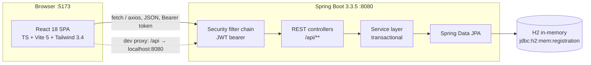
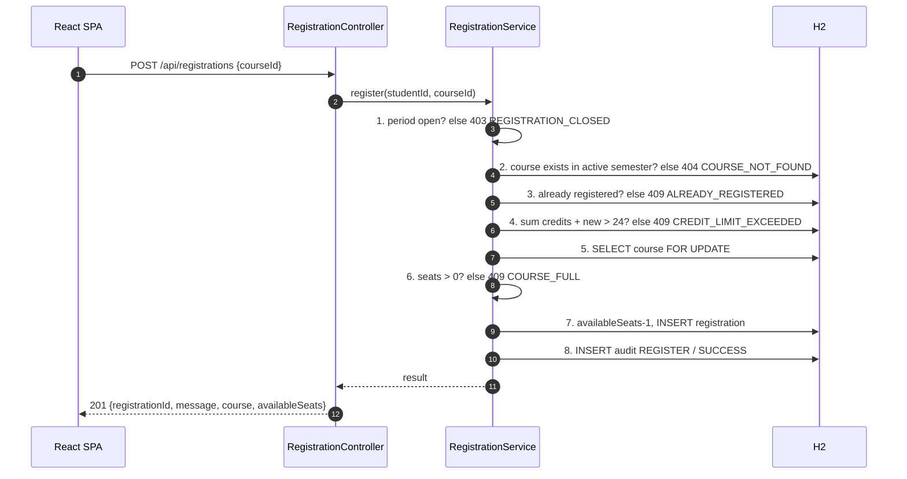
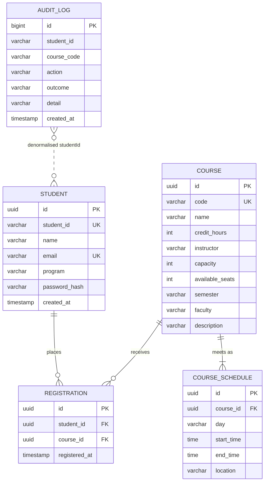

# 00 — System Overview & Contract Reference

**Project:** Monash Course Registration System — Phase 1
**Status:** Approved for build (spec baseline v1.0)
**Source of truth:** [`../../ORCHESTRATION.md`](../../ORCHESTRATION.md). Where this document and
ORCHESTRATION.md disagree, ORCHESTRATION.md wins and this document is defective.
**Audience:** coder-backend, coder-frontend, tester, reviewer.

---

## 1. Purpose

Phase 1 delivers a single, coherent student-facing workflow: **log in → browse the semester
catalogue → register → review your timetable → drop**. It must look and feel like a serious
university product ("fancy university"), and it must be *correct under concurrency* — the seat
counter is the one place where a plausible-looking implementation is routinely wrong.

The system is a teaching-scale, single-semester, single-university application. It is not a
general student administration system.

---

## 2. Personas

| ID | Persona | Goals | Phase 1 |
| --- | --- | --- | --- |
| P1 | **Student** (Aisha, Daniel, Priya) | Find courses, secure a seat before they fill, keep the timetable clash-free-by-eye, drop something they regret | Primary actor, full UI |
| P2 | **Course administrator** | Create courses, open/close the window, raise capacity | **Out of scope** — data is seeded |
| P3 | **Registrar / support officer** | Investigate "why did my registration fail?" | Read-only via `AuditLog` rows (no UI) |
| P4 | **Developer / tester / reviewer** | Build, verify, audit | Consumes this spec set |

---

## 3. Scope

### 3.1 In scope

- FR1 Student login (JWT + BCrypt), FR2 catalogue browse/search, FR3 registration,
  FR4 drop, FR5 registered-course view + CSV + print, FR6 capacity validation (incl. concurrency),
  FR7 registration-period control.
- NFR1 performance, NFR2 security, NFR3 availability, NFR4 audit logging, NFR5 usability.
- Responsive desktop + mobile web, keyboard accessible, WCAG 2.1 AA contrast.
- Seeded demo data (3 students, 16 active-semester courses, 3 prior-semester courses).

### 3.2 Non-goals (explicitly out of Phase 1)

| # | Non-goal | Rationale |
| --- | --- | --- |
| NG1 | Admin/CRUD UI for courses, students, periods | No admin persona in Phase 1 |
| NG2 | Timetable **clash detection** | Requires a scheduling engine; Phase 2. The UI shows times, it does not validate overlaps |
| NG3 | Prerequisites / corequisites / program rules | Catalogue is open enrolment |
| NG4 | Waitlists, seat offers, approvals | Contract defines hard 409 `COURSE_FULL` only |
| NG5 | Payments, fees, invoices | Out of domain |
| NG6 | Self-registration, password reset, MFA, SSO | Students are pre-provisioned; password is seeded |
| NG7 | Persistence across restarts | H2 in-memory, `create-drop` by design |
| NG8 | Pagination / infinite scroll of catalogue | ≤ 200 courses; single response |
| NG9 | i18n / RTL / dark mode | English, light theme only |
| NG10 | Email/SMS notifications, calendar (ICS) export | Not in contract |
| NG11 | Server-side rendering, SEO | Authenticated SPA |

---

## 4. Glossary

| Term | Definition |
| --- | --- |
| **Semester** | A teaching period identified by `code`, e.g. `2026-S2`. Exactly one is *active*. |
| **Active semester** | The semester configured by `app.registration.active-semester`. The catalogue defaults to it. |
| **Credit point (cp)** | Unit of course weight. Values: `3` or `6`. |
| **Capacity** | Maximum enrolments a course permits. Immutable in Phase 1. |
| **Available seats** | `capacity − current enrolments`. Invariant: `0 ≤ availableSeats ≤ capacity`. |
| **Full** | `availableSeats = 0`. Registration returns 409 `COURSE_FULL`. |
| **Registration** | A persisted `(student, course)` link with a timestamp. Unique per pair. |
| **Drop** | Deletion of a registration; returns one seat. |
| **Registration window** | Half-open? **No** — closed interval `[startAt, endAt]`, inclusive at both ends (see FR7-AC3/AC4). |
| **Seat meter** | UI component showing `availableSeats / capacity`. |
| **Catalogue** | The list of courses in one semester. |
| **Audit log** | Append-only record of every register/drop *attempt*, successful or not (NFR4). |
| **Session** | Client-side possession of a valid JWT. There is no server session. |

---

## 5. Architecture



**Hard rules**

1. The SPA never hardcodes `http://localhost:8080`. All calls use relative `/api/...`
   (Vite dev proxy, `vite.config.ts` `server.proxy['/api']`; documented in ORCHESTRATION.md).
2. The server is the **only** authority on time, seat counts and period state. The client may render a
   countdown but must never gate a mutation on client time.
3. Every mutating request is authenticated and re-validated server-side. Client-side disabling is UX,
   not security.

### 5.1 Request lifecycle (register)



The numeric order in steps 1–6 is **normative** (see §9.3, ambiguity A-03).

---

## 6. Module map

### 6.1 Backend (`edu.monash.registration`)

| Package | Responsibility | Must not |
| --- | --- | --- |
| `config` | `SecurityConfig`, `JwtProperties`, `RegistrationProperties`, `CorsConfig`, `ClockConfig` | contain business rules |
| `security` | `JwtService` (issue/parse), `JwtAuthenticationFilter`, `StudentPrincipal` | touch JPA entities directly |
| `domain` | `Student`, `Course`, `CourseSchedule`, `Registration`, `AuditLog`, enums `DayOfWeekCode`, `AuditAction`, `AuditOutcome` | contain HTTP types |
| `repository` | Spring Data interfaces, `@Lock(PESSIMISTIC_WRITE)` finder for register | contain business rules |
| `service` | `AuthService`, `CatalogService`, `RegistrationService`, `RegistrationPeriodService`, `AuditService`, `CsvExportService` | build HTTP responses |
| `api` | `AuthController`, `CatalogController`, `RegistrationController`, `GlobalExceptionHandler`, `dto/*` | contain persistence logic |
| `seed` | `DataSeeder` (`CommandLineRunner`) | run in `test` profile *silently inconsistent* with §8 |

### 6.2 Frontend (`frontend/src`)

| Path | Responsibility |
| --- | --- |
| `api/client.ts` | axios instance, base `/api`, bearer interceptor, 401 → logout, error normalisation |
| `api/{auth,courses,registrations}.ts` | typed endpoint wrappers |
| `auth/AuthContext.tsx` | token + student profile, `login()`, `logout()`, hydration from `localStorage` |
| `auth/RequireAuth.tsx` | route guard, preserves intended path for post-login redirect |
| `components/ui/*` | design-system primitives (§09) |
| `components/*` | `CourseCard`, `SeatMeter`, `CreditMeter`, `StatusBanner`, `ConfirmDialog`, `Toast`, `Skeleton`, `EmptyState`, `Header`, `Footer` |
| `pages/*` | `Login`, `Dashboard`, `Catalog`, `CourseDetail`, `Schedule`, `NotFound` |
| `hooks/*` | `useCourses`, `useDebouncedValue`, `useRegistrationPeriod`, `useToast` |
| `lib/format.ts` | time, date, credit formatting |
| `styles/index.css` | Tailwind layers, font imports, print stylesheet |

Routes: `/login`, `/` (Dashboard), `/catalog`, `/courses/:id`, `/schedule`, `*` (NotFound).
All except `/login` and `*` are behind `RequireAuth`.

---

## 7. Data model

### 7.1 ERD



`AUDIT_LOG` deliberately has **no foreign keys** (dotted line = logical, not enforced): audit rows
must survive course deletion and must record attempts for codes that never resolved.

### 7.2 `student`

| Column | Type | Constraints | Notes |
| --- | --- | --- | --- |
| `id` | `UUID` | PK, not null | generated (`GenerationType.UUID`) |
| `student_id` | `VARCHAR(8)` | unique, not null, `^[0-9]{8}$` | JWT subject; business key |
| `name` | `VARCHAR(120)` | not null | |
| `email` | `VARCHAR(160)` | unique, not null, RFC-5322-ish | `@student.monash.edu` |
| `program` | `VARCHAR(16)` | not null | `BCS`, `BSE`, `BBIS` |
| `password_hash` | `VARCHAR(60)` | not null | BCrypt, `$2a$10$…` |
| `created_at` | `TIMESTAMP` | not null | UTC |

Never serialised: `password_hash`. No `Student` DTO may expose it (NFR2).

### 7.3 `course`

| Column | Type | Constraints | Notes |
| --- | --- | --- | --- |
| `id` | `UUID` | PK | stable, seeded with fixed UUIDs (§8.4) |
| `code` | `VARCHAR(10)` | unique, not null, `^[A-Z]{3}[0-9]{4}$` | e.g. `FIT1045` |
| `name` | `VARCHAR(160)` | not null | |
| `credit_hours` | `INT` | not null, `CHECK (credit_hours IN (3,6))` | |
| `instructor` | `VARCHAR(120)` | not null | `Dr …` |
| `capacity` | `INT` | not null, `CHECK (capacity >= 0)` | `0` is legal (A-18) but unused by the seed; the full demo row is capacity 1 (A-16) |
| `available_seats` | `INT` | not null, `CHECK (available_seats >= 0 AND available_seats <= capacity)` | mutated only under lock |
| `semester` | `VARCHAR(10)` | not null, indexed | `2026-S1`, `2026-S2` |
| `faculty` | `VARCHAR(80)` | not null | |
| `description` | `VARCHAR(1000)` | not null | plain text, no HTML |

**Invariant C1:** `available_seats + count(registration where course_id = id) = capacity`, always,
outside an in-flight transaction.

### 7.4 `course_schedule`

| Column | Type | Constraints | Notes |
| --- | --- | --- | --- |
| `id` | `UUID` | PK | |
| `course_id` | `UUID` | FK → `course.id`, `ON DELETE CASCADE`, not null | |
| `day` | `VARCHAR(3)` | not null, `CHECK (day IN ('MON','TUE','WED','THU','FRI','SAT','SUN'))` | |
| `start_time` | `TIME` | not null | |
| `end_time` | `TIME` | not null, `CHECK (end_time > start_time)` | |
| `location` | `VARCHAR(120)` | not null | e.g. `Clayton, Building 25, Rm 125` |

A course has **1..n** slots. Ordering for serialisation: day (MON→SUN), then `start_time`.

### 7.5 `registration`

| Column | Type | Constraints | Notes |
| --- | --- | --- | --- |
| `id` | `UUID` | PK | returned as `registrationId` |
| `student_id` | `UUID` | FK → `student.id`, not null | |
| `course_id` | `UUID` | FK → `course.id`, not null | |
| `registered_at` | `TIMESTAMP` | not null | UTC instant, set server-side |

**Unique constraint `uk_registration_student_course (student_id, course_id)`** — the duplicate
defence. A `DataIntegrityViolationException` on this key must be mapped to 409 `ALREADY_REGISTERED`,
never 500.

### 7.6 `audit_log`

| Column | Type | Constraints | Notes |
| --- | --- | --- | --- |
| `id` | `BIGINT` | PK, identity | |
| `student_id` | `VARCHAR(8)` | not null, indexed | business id, not FK |
| `course_code` | `VARCHAR(10)` | nullable | null only if course id unresolvable |
| `action` | `VARCHAR(20)` | not null, `CHECK IN ('REGISTER','DROP','REGISTER_REJECTED')` | |
| `outcome` | `VARCHAR(10)` | not null, `CHECK IN ('SUCCESS','FAILURE')` | |
| `detail` | `VARCHAR(255)` | nullable | failure reason code or human note |
| `created_at` | `TIMESTAMP` | not null | UTC |

See NFR4 (§[08](./08-non-functional.md)) for the exact event matrix.

---

## 8. Seed data (normative for tests)

### 8.1 Students — password `Password123!` (BCrypt cost 10)

| studentId | Name | Email | Program |
| --- | --- | --- | --- |
| `32012345` | Aisha Rahman | aisha.rahman@student.monash.edu | BCS |
| `32067890` | Daniel Tan | daniel.tan@student.monash.edu | BSE |
| `32011111` | Priya Nair | priya.nair@student.monash.edu | BBIS |

### 8.2 Active semester `2026-S2` — 16 courses

| Code | Name | cp | Capacity | Seats | Faculty |
| --- | --- | --- | --- | --- | --- |
| `FIT1045` | Introduction to Programming | 6 | 120 | 120 | Information Technology |
| `FIT1051` | Programming Foundations | 6 | 100 | 100 | Information Technology |
| `FIT1055` | Industry Experience | 3 | 30 | 30 | Information Technology |
| `FIT2004` | Algorithms and Data Structures | 6 | 80 | 80 | Information Technology |
| `FIT2099` | Object Oriented Design | 6 | 60 | 60 | Information Technology |
| `FIT2101` | Business Process Modelling | 6 | 55 | 55 | Information Technology |
| `FIT3077` | Software Engineering: Architecture and Design | 6 | 45 | 45 | Information Technology |
| `FIT3143` | Parallel Computing | 6 | **1** | **1** | Information Technology |
| `FIT3179` | Data Visualisation | 6 | 50 | 50 | Information Technology |
| `FIT3182` | Big Data Management | 6 | **1** | **0** | Information Technology |
| `ECF1100` | Principles of Economics | 6 | 90 | 90 | Business |
| `ENG1001` | Engineering Design | 6 | 70 | 70 | Engineering |
| `LAW1111` | Foundations of Law | 6 | 65 | 65 | Law |
| `MTH1010` | Functions and Their Applications | 3 | 40 | 40 | Science |
| `MTH1030` | Techniques for Modelling | 6 | 75 | 75 | Science |
| `SCI1020` | Science of Nature | 6 | 85 | 85 | Science |

`FIT3143` = the single-seat course for full-course tests (1 seat **free**).
`FIT3182` = the permanently-full course: `capacity = 1`, `availableSeats = 0`, backed by **one**
seeded registration owned by `32067890` (Daniel Tan) — see A-16. It is full because a seat is taken,
not because a count was fabricated; **C1 holds for every seeded course**, including this one.
`FIT1045` must have **2** schedule slots (multi-slot test); every other course 1 slot.
`FIT2099`, `FIT3077` intentionally overlap in time (documents that clashes are *not* detected — NG2).

### 8.3 Prior semester `2026-S1` — 3 courses (must never appear in `2026-S2` results)

`FIT1008` Introduction to Computer Science (6cp, 80/80),
`FIT1047` Introduction to Computer Systems (6cp, 90/90),
`MTH1020` Analysis of Change (6cp, 60/60).

### 8.4 Stable identifiers

Seeder must use **fixed UUIDs** (constant `UUID.fromString(...)` values) and fixed codes so
integration tests can reference rows without lookup-by-name. Seeder is idempotent: if
`studentRepository.count() > 0`, it does nothing.

---

## 9. API contract (restated precisely)

Base path `/api`. JSON only, `Content-Type: application/json; charset=UTF-8` (except CSV).
Timestamps: see §9.6. Auth: `Authorization: Bearer <jwt>`.

### 9.1 Error envelope

```json
{
  "error": {
    "code": "COURSE_FULL",
    "message": "FIT3143 has no available seats.",
    "timestamp": "2026-11-08T11:26:41+08:00"
  }
}
```

- `code` — UPPER_SNAKE, stable, machine-readable. Frontend branches on this, never on `message`.
- `message` — human-readable English, safe to display but not contractual. May name the course.
- `timestamp` — ISO-8601 with offset, server clock.
- No stack traces, no exception class names, no SQL. (NFR2)

### 9.2 Error catalogue

| HTTP | `code` | Trigger | Endpoint(s) |
| --- | --- | --- | --- |
| 400 | `VALIDATION_ERROR` | missing/blank/malformed request field (including a non-UUID `courseId` in the body), too-long `q`, unknown `semester`, unparseable JSON | all |
| 401 | `INVALID_CREDENTIALS` | unknown studentId **or** wrong password (identical response) | `POST /auth/login` |
| 401 | `UNAUTHORIZED` | missing, malformed, expired or bad-signature token | all authenticated |
| 403 | `REGISTRATION_CLOSED` | `serverTime` outside `[startAt, endAt]` | `POST /registrations`, `DELETE /registrations/{id}` |
| 403 | `NOT_OWNER` | registration exists but belongs to another student | `DELETE /registrations/{id}` |
| 404 | `COURSE_NOT_FOUND` | unknown course id, **or** course not in the active semester (detail `SEMESTER_NOT_ACTIVE`, A-17) | `GET /courses/{id}`, `POST /registrations` |
| 404 | `REGISTRATION_NOT_FOUND` | unknown registration id, already dropped, **or a malformed/non-UUID `registrationId`** (path ids are opaque: treated as not found, never 400; the attempt is still audited as `DROP/FAILURE` with `detail = VALIDATION_ERROR`, A-19) | `DELETE /registrations/{id}` |
| 409 | `COURSE_FULL` | `availableSeats = 0` | `POST /registrations` |
| 409 | `ALREADY_REGISTERED` | unique `(student, course)` already exists | `POST /registrations` |
| 409 | `CREDIT_LIMIT_EXCEEDED` | `totalCredits + course.creditHours > 24` | `POST /registrations` |
| 500 | `INTERNAL_ERROR` | unexpected server fault (never leaks detail) | all |

`UNAUTHORIZED` and `INTERNAL_ERROR` are **elaborations** consistent with the frozen envelope; the
contract names only the codes above them.

A malformed path identifier is the one exception to the 400 row: `DELETE /api/registrations/{id}`
with a non-UUID value returns `404 REGISTRATION_NOT_FOUND`, exactly like an unknown id, because path
ids are opaque (FR4 §3). The audit row still records `detail = VALIDATION_ERROR`, so the two cases
remain distinguishable in the audit trail (A-19).

### 9.3 Endpoint reference

| # | Method | Path | Auth | Success | Failures |
| --- | --- | --- | --- | --- | --- |
| E1 | POST | `/api/auth/login` | public | 200 | 400, 401 |
| E2 | GET | `/api/auth/me` | bearer | 200 | 401 |
| E3 | GET | `/api/semesters` | public | 200 | — |
| E4 | GET | `/api/courses?semester=&q=` | bearer | 200 | 400, 401 |
| E5 | GET | `/api/courses/{id}` | bearer | 200 | 401, 404 |
| E6 | GET | `/api/registration-period` | public | 200 | — |
| E7 | GET | `/api/registrations` | bearer | 200 | 401 |
| E8 | POST | `/api/registrations` | bearer | 201 | 400, 401, 403, 404, 409 |
| E9 | DELETE | `/api/registrations/{registrationId}` | bearer | 200 | 401, 403, 404 |
| E10 | GET | `/api/registrations/export` | bearer | 200 `text/csv` | 401 |

**Validation precedence** for E8 (normative): auth → body → period → course exists in the active
semester (A-17) → duplicate → credit limit → capacity. For E9: auth → registration exists →
ownership → period.

### 9.4 Payloads

#### E1 `POST /api/auth/login`

```json
{ "studentId": "32012345", "password": "Password123!" }
```

`200`:

```json
{
  "token": "eyJhbGciOiJIUzI1NiJ9...",
  "student": {
    "studentId": "32012345",
    "name": "Aisha Rahman",
    "email": "aisha.rahman@student.monash.edu",
    "program": "BCS"
  }
}
```

Rules: `studentId` trimmed before lookup; `password` **not** trimmed; `studentId` must match
`^[0-9]{8}$`, `password` 1–72 chars (BCrypt limit) → else 400. Unknown id and wrong password return
byte-identical 401 bodies apart from `timestamp`.

#### E2 `GET /api/auth/me` → `200` student object (same shape as `student` above).

#### E3 `GET /api/semesters`

```json
[
  { "code": "2026-S2", "name": "Semester 2 2026", "active": true },
  { "code": "2026-S1", "name": "Semester 1 2026", "active": false }
]
```

Ordered `code` DESC. `name` derived: `Semester {n} {year}` from `YYYY-Sn`.

#### E4 `GET /api/courses?semester=2026-S2&q=algo`

- `semester` absent → configured active semester. Unknown code → 400 `VALIDATION_ERROR`.
- `q` trimmed; blank/absent → all. Case-insensitive substring on **code OR name**. `q` length > 100 →
  400 `VALIDATION_ERROR`.
- Result ordered `code` ASC. `200 []` for no matches — never 404.

`200` (array of course objects):

```json
[
  {
    "id": "6f1c2f7e-0d5a-4a3e-9c1b-2d7c9a1e4b10",
    "code": "FIT2004",
    "name": "Algorithms and Data Structures",
    "creditHours": 6,
    "instructor": "Dr Wei Chen",
    "capacity": 80,
    "availableSeats": 80,
    "semester": "2026-S2",
    "faculty": "Information Technology",
    "description": "Algorithm design paradigms, complexity analysis and core data structures.",
    "schedule": [
      {
        "day": "TUE",
        "startTime": "10:00",
        "endTime": "12:00",
        "location": "Clayton, Building 25, Rm 125"
      }
    ]
  }
]
```

#### E5 `GET /api/courses/{id}` → `200` single course object; unknown/invalid UUID → 404 `COURSE_NOT_FOUND`.

#### E6 `GET /api/registration-period`

```json
{
  "semester": "2026-S2",
  "startAt": "2026-10-01T00:00:00+08:00",
  "endAt": "2026-12-20T23:59:59+08:00",
  "open": true,
  "serverTime": "2026-11-08T11:26:41+08:00"
}
```

`open = !serverTime.isBefore(startAt) && !serverTime.isAfter(endAt)`.

#### E7 `GET /api/registrations`

```json
{
  "semester": "2026-S2",
  "totalCredits": 12,
  "maxCredits": 24,
  "items": [
    {
      "registrationId": "1b7e5c44-6c2f-4c9e-8a11-3f0d2c9b7a55",
      "registeredAt": "2026-11-08T03:26:41Z",
      "course": { "…": "full course object as E4" }
    }
  ]
}
```

`totalCredits` = Σ `course.creditHours`. `maxCredits` constant `24`. Items ordered `registeredAt` ASC,
then `course.code` ASC. Empty → `{"semester":…,"totalCredits":0,"maxCredits":24,"items":[]}`.

#### E8 `POST /api/registrations`

```json
{ "courseId": "6f1c2f7e-0d5a-4a3e-9c1b-2d7c9a1e4b10" }
```

`201`:

```json
{
  "registrationId": "1b7e5c44-6c2f-4c9e-8a11-3f0d2c9b7a55",
  "message": "Registered for FIT2004 Algorithms and Data Structures.",
  "course": { "…": "course object, availableSeats already decremented" },
  "availableSeats": 79
}
```

`courseId` must be a syntactically valid UUID → else 400 `VALIDATION_ERROR`. Well-formed but unknown
UUID → 404 `COURSE_NOT_FOUND`.

#### E9 `DELETE /api/registrations/{registrationId}`

`200`:

```json
{ "message": "Dropped FIT2004 Algorithms and Data Structures.", "availableSeats": 80 }
```

#### E10 `GET /api/registrations/export`

`200`, headers:

```
Content-Type: text/csv; charset=UTF-8
Content-Disposition: attachment; filename="course-list.csv"
```

Body (RFC 4180, CRLF line endings, UTF-8, **no BOM**, all fields quoted only when they contain
`,` `"` or newline; `"` doubled):

```csv
Course Code,Course Name,Credit Hours,Instructor,Day,Time,Location
FIT1045,Introduction to Programming,6,Dr Alan Ng,MON,10:00-12:00,"Clayton, Building 25, Rm 125"
FIT1045,Introduction to Programming,6,Dr Alan Ng,WED,14:00-16:00,"Clayton, Building 25, Rm 130"
```

One row **per registration × schedule slot**; a two-slot course emits two rows. Order: `course.code`
ASC, then day MON→SUN, then `startTime`. No registrations → header row only (still 200).

### 9.5 Auth matrix

| Request | No token | Valid token | Expired/bad signature |
| --- | --- | --- | --- |
| E1, E3, E6 | 200 | 200 | 200 (ignored) |
| E2, E4, E5, E7, E8, E9, E10 | 401 `UNAUTHORIZED` | proceed | 401 `UNAUTHORIZED` |

There are **no roles** in Phase 1. Authorisation is limited to "is this your registration?" (E9).

### 9.6 Time & number formats

| Field | Format | Example |
| --- | --- | --- |
| `registeredAt`, `createdAt` | ISO-8601 instant, UTC, `Z` | `2026-11-08T03:26:41Z` |
| `startAt`, `endAt`, `serverTime` | ISO-8601 with offset | `2026-11-08T11:26:41+08:00` |
| `startTime`, `endTime` | `HH:mm` 24-hour | `09:30` |
| `day` | `MON`…`SUN` | `TUE` |
| credits, seats, capacity | JSON number, integer | `6` |
| UUIDs | lowercase canonical | `6f1c2f7e-…` |

Period config values (`app.registration.period-*`) are wall-clock in the university zone
(`Asia/Kuala_Lumpur`, offset `+08:00`) and must be serialised with that offset. Tests compare
**instants**, not strings.

### 9.7 HTTP semantics

- `404` vs `403` on E9: existence first (404), then ownership (403), then period (403). This avoids
  leaking other students' registration ids as 403 when they do not exist for the caller.
- Duplicate `POST` is **not** idempotent-friendly: it returns 409, it does not silently succeed.
- No `ETag`, no caching headers on API responses (`Cache-Control: no-store`).
- CORS: only `http://localhost:5173` (config `app.cors.allowed-origins`), methods
  `GET,POST,DELETE,OPTIONS`, header `Authorization`, `Content-Type`; no credentials (bearer only).

---

## 10. Resolved ambiguities (decisions of record)

| ID | Ambiguity | Resolution | Where |
| --- | --- | --- | --- |
| A-01 | "one course at capacity 0 seeded as full" | **Superseded by A-16**: the seeded full course is `capacity = 1` with exactly one registration held by another student, so `availableSeats = 0` and C1 holds. Capacity `0` remains legal at schema level (A-18) but is not used by the seed | §8.2, [11](./11-decisions.md) |
| A-02 | Enum lacks a rejected-drop action | Failed drops are `action=DROP, outcome=FAILURE`; failed registrations are `action=REGISTER_REJECTED, outcome=FAILURE`. No new enum values | NFR4 |
| A-03 | Order of 409 checks in E8 | period → exists → duplicate → credit limit → capacity (capacity last, inside the lock) | §9.3 |
| A-04 | Wrong password vs unknown user | Same 401 `INVALID_CREDENTIALS`; dummy BCrypt compare to equalise timing | FR1 |
| A-05 | Unknown `semester` query value | 400 `VALIDATION_ERROR` (not empty list) — surfaces client bugs | FR2 |
| A-06 | Empty catalogue/registrations | `200 []` / `200` with empty items; never 404 | FR2, FR5 |
| A-07 | Period boundary inclusivity | Both endpoints inclusive (`open` at exactly `startAt` and exactly `endAt`) | FR7 |
| A-08 | CSV with no registrations | 200 + header row only | FR5 |
| A-09 | Timestamps | Instants in UTC `Z`; period wall-clock with `+08:00` | §9.6 |
| A-10 | Login attempts in `AuditLog` | **No** — `AuditLog` is registration-scoped. Login success/failure goes to the application log (`INFO`/`WARN`) with studentId, never password | FR1, NFR4 |
| A-11 | Token storage | `localStorage` key `monash.token`; accepted XSS trade-off for Phase 1, mitigated by no `dangerouslySetInnerHTML` and no third-party scripts | FR1, NFR2 |
| A-12 | Client clock trust | Never. `open` and mutations are server-authoritative; UI uses `serverTime` offset | FR7 |
| A-13 | Course list ordering | `code` ASC everywhere (catalogue, registrations items tiebreak) | §9.4 |
| A-14 | `q` matching scope | `code` OR `name` only — not `instructor`, not `faculty` | FR2 |

**The series continues at A-16 in [11 — Decision Log](./11-decisions.md)** (A-15 is unassigned; see the
note there). A-16…A-19 cover the seed-as-full-course shape, the non-active-semester registration path,
the normative schema constraints, and validation-rejected audit rows. Decisions in 11 supersede the
text they name.

---

## 11. Assumptions

| ID | Assumption | If false |
| --- | --- | --- |
| AS1 | Single university, single timezone `Asia/Kuala_Lumpur` | Period maths changes; FR7 invalid |
| AS2 | One active semester at a time | Catalogue scoping changes |
| AS3 | ≤ 200 courses per semester, ≤ 40 per student | No pagination needed |
| AS4 | Students pre-provisioned; credentials seeded | FR1 needs registration flow |
| AS5 | `maxCredits = 24` for every student, no per-program variation | Credit rule changes |
| AS6 | Enrolment is open — no prerequisites, no approvals | FR3 gains a rule engine |
| AS7 | Data loss on restart is acceptable for the demo | Persistence work required |
| AS8 | Modern evergreen browsers (last 2 versions) | Transpile targets change |
| AS9 | Network latency to the API < 150 ms locally | NFR1 thresholds need restating |
| AS10 | No admin writes during a demo run | Concurrency tests can assume static catalogue |

---

## 12. Risks

| ID | Risk | Likelihood | Impact | Mitigation |
| --- | --- | --- | --- | --- |
| RK1 | Oversell under concurrency (read-modify-write without lock) | High if unguided | Severe — breaks FR6 | `SELECT … FOR UPDATE` + mandatory `CapacityConcurrencyTest` |
| RK2 | Duplicate registrations from double-click / retry | Medium | Medium | Unique constraint + 409 mapping |
| RK3 | H2 behaves differently from PostgreSQL | Low | Medium | `MODE=PostgreSQL`; no vendor-specific SQL; no native queries |
| RK4 | Timezone drift in period logic | Medium | High | Injectable `Clock`; `serverTime` in payload; tests parse instants |
| RK5 | Default JWT secret shipped to production | Certain | High | Env var `JWT_SECRET`; README warns; spec marks dev-only |
| RK6 | Seed drift breaks tester's fixed expectations | Medium | High | §8 is normative; fixed UUIDs; seeder idempotent |
| RK7 | Design drift between two frontend passes | Medium | Medium | §[09](./09-ui-design-system.md) is prescriptive (tokens, sizes, states) |
| RK8 | Token theft via XSS | Low | High | No `dangerouslySetInnerHTML`; no remote scripts; short 120-min expiry |
| RK9 | BCrypt cost 10 slows login under load | Low | Low | Acceptable at demo scale; documented |
| RK10 | Scope creep into clash detection / waitlists | High | Medium | NG2, NG4 stated as non-goals |

---

## 13. Traceability index

| Requirement | Spec file | Owner |
| --- | --- | --- |
| FR1 Student Login | [01-fr1-student-login.md](./01-fr1-student-login.md) | backend + frontend |
| FR2 View Available Courses | [02-fr2-view-courses.md](./02-fr2-view-courses.md) | backend + frontend |
| FR3 Register for Course | [03-fr3-register-course.md](./03-fr3-register-course.md) | backend + frontend |
| FR4 Drop Course | [04-fr4-drop-course.md](./04-fr4-drop-course.md) | backend + frontend |
| FR5 View Registered Courses | [05-fr5-view-registered.md](./05-fr5-view-registered.md) | backend + frontend |
| FR6 Capacity Validation | [06-fr6-capacity.md](./06-fr6-capacity.md) | backend (critical) |
| FR7 Registration Period | [07-fr7-registration-period.md](./07-fr7-registration-period.md) | backend + frontend |
| NFR1–NFR5 | [08-non-functional.md](./08-non-functional.md) | all |
| UI design system | [09-ui-design-system.md](./09-ui-design-system.md) | frontend |
| Test strategy | [10-test-strategy.md](./10-test-strategy.md) | tester |
| Decisions A-16…A-19 | [11-decisions.md](./11-decisions.md) | planner |

**User stories** (referenced by every FR file):

| ID | Story |
| --- | --- |
| US1 | As a student, I want to sign in securely so that I can reach my own registration workspace. |
| US2 | As a student, I want to browse and search this semester's courses and register for the ones I want, so that I can build my timetable. |
| US3 | As a student, I want to review everything I am registered in and drop a course, so that I stay in control of my workload. |
| US4 | As a student, I want registration to obey the official window and capacity rules, so that enrolment is fair and predictable. |

---

*Next: [01 — FR1 Student Login](./01-fr1-student-login.md)*
