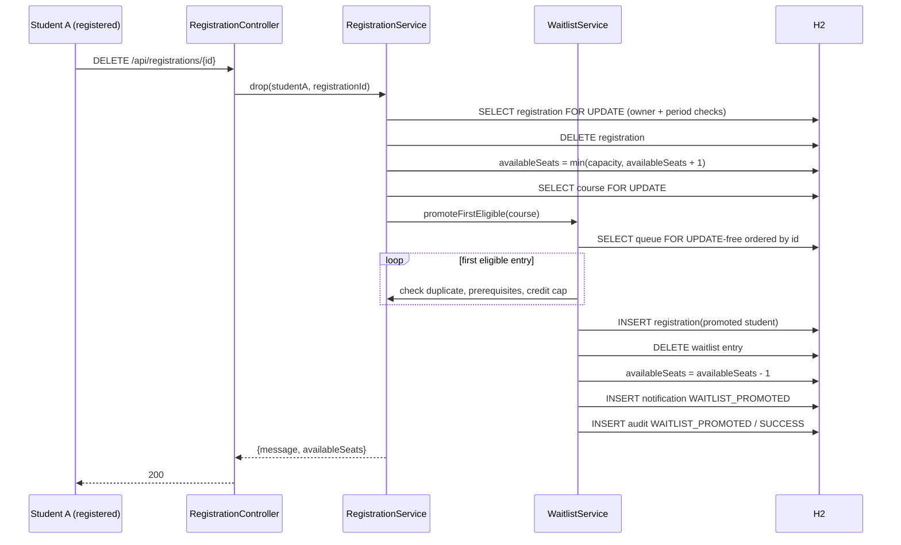

# 13 — FR11 Waitlist Management

**Story:** US2, US4 · **Actors:** Student (P1), System (authoritative)
**Endpoints:** `GET /api/waitlist` (E11), `POST /api/waitlist` (E12),
`DELETE /api/waitlist/{waitlistId}` (E13), `GET /api/notifications` (E14),
`POST /api/notifications/{notificationId}/read` (E15) — plus the existing
`DELETE /api/registrations/{id}` (E9) promotion hook.
**Depends on:** [FR3](./03-fr3-register-course.md), [FR4](./04-fr4-drop-course.md),
[FR6](./06-fr6-capacity.md), [FR7](./07-fr7-registration-period.md),
[FR8](./12-fr8-prerequisites.md).
**Phase:** 2 (second Phase 2 requirement; Phase 1 remains FR1–FR7).

> This feature replaces Phase 1 non-goal **NG4** ("Waitlists, seat offers, approvals").
> The Phase 1 rule "a 409 `COURSE_FULL` is final, there is no waitlist" (`06` B12) is
> **superseded** by this document and by [A-22](./11-decisions.md#a-22--phase-2-fr11-waitlist-model-promotion-and-notifications).

---

## 1. Requirement

> Students may join a waitlist when a course reaches capacity.
>
> - Students can join a waitlist for full courses.
> - Waitlist position is displayed.
> - When a seat becomes available, the first student in the waitlist receives the seat.
> - Waitlisted students receive notification.
>
> Example: capacity = 30. Student #31 joins the waitlist. Position shown = 1.

"Seat becomes available" means a registration is dropped through E9. The first eligible student in
the queue is enrolled **automatically**, in the same transaction as the drop; there is no offer
acceptance step (see §2.2). "Notification" is an **in-app** notification (see §2.3).

---

## 2. Decisions and scope

### 2.1 Queue model

- One row in `waitlist_entry` per `(student, course)`, enforced by
  `uk_waitlist_student_course (student_id, course_id)`.
- The queue is **FIFO by `waitlist_entry.id`** (database identity, assigned while the course row lock
  is held). The student-facing **position is derived**, never stored:
  `position = 1 + count(entries for the course with a lower id)`.
- Because positions are derived, a leave or a promotion shifts everyone behind it up by one
  immediately, with no renumbering job and no stale positions.
- Membership is per course and per student; a student may queue for several full courses.

### 2.2 Automatic promotion, not seat offers

- A drop of a registration triggers promotion of the first **eligible** student in the queue, in the
  same transaction, under the same course row lock that protects the seat counter (FR6).
- Promotion creates a normal `registration` row for the promoted student and consumes the freed
  seat: `availableSeats` ends unchanged (0 for an always-full course), never oversold.
- There is no offer/acceptance window and no expiry. NG4's "seat offers" remain out of scope.
- A student is never enrolled if doing so would break FR8 (prerequisites) or the 24-credit cap
  (FR3/FR6). Entries that are no longer eligible are **skipped, not deleted**; the next eligible
  student receives the seat. A skipped entry stays queued and can be promoted by a later drop if
  the student becomes eligible again.

### 2.3 Notifications are in-app

- NG10 still holds: no email, SMS or push transport.
- `notification` rows are persisted in the same transaction as the event and are read from
  `GET /api/notifications`; the application header shows a bell with the unread count.
- Two events are notified: `WAITLIST_JOINED` (with the position at join time) and
  `WAITLIST_PROMOTED` (automatic enrolment after a drop).
- Notifications are historical event records. A late position change does not rewrite old messages;
  the live position is always served by E11.

### 2.4 Lifecycle rules (summary)

| Event | Queue effect |
| --- | --- |
| Join a full active-semester course in the open window | append entry, notify `WAITLIST_JOINED` |
| Join a course that is not full | rejected `409 SEAT_AVAILABLE` — register directly |
| Leave | delete entry; everyone behind moves up one; allowed even after the window closes |
| Successful direct registration | delete that student's entry for the same course (cleared silently) |
| Drop a registration | add the seat back, then promote the first eligible entry |
| Cancel an enrolment | not possible; the system never revokes a promoted seat behind the student's back |
| Registration window closes | no joins; existing entries stay queued for the next drop that can happen |

---

## 3. Domain model

### 3.1 `waitlist_entry`

| Column | Type | Constraints | Notes |
| --- | --- | --- | --- |
| `id` | `BIGINT` | PK, identity | **queue order**; generated while holding the course row lock |
| `student_id` | `UUID` | FK → `student.id`, not null | |
| `course_id` | `UUID` | FK → `course.id`, not null | |
| `joined_at` | `TIMESTAMP` | not null | server clock, UTC; display only |

**Unique constraint `uk_waitlist_student_course (student_id, course_id)`.** Index
`idx_waitlist_course (course_id)` for queue reads. Position is not a column.

### 3.2 `notification`

| Column | Type | Constraints | Notes |
| --- | --- | --- | --- |
| `id` | `BIGINT` | PK, identity | |
| `student_id` | `UUID` | FK → `student.id`, not null | recipient |
| `course_id` | `UUID` | FK → `course.id`, not null | the course the event concerns |
| `type` | `VARCHAR(30)` | not null, `WAITLIST_JOINED` \| `WAITLIST_PROMOTED` | |
| `message` | `VARCHAR(255)` | not null | student-facing English, includes the course code |
| `created_at` | `TIMESTAMP` | not null | server clock, UTC |
| `read_at` | `TIMESTAMP` | nullable | null = unread; set once, idempotent |

Indexes: `idx_notification_student (student_id)`,
`idx_notification_student_unread (student_id, read_at)`.

### 3.3 Invariants

- **W1** — At most one queue row per student per course.
- **W2** — Every queue row belongs to a course in the active semester at join time; entries survive a
  semester change but E11 only lists the active semester.
- **W3** — A queue may only exist for a full course. The only way a seat becomes free while the queue
  remains is an ineligible-first-entry skip (then the free seat is correctly visible).
- **C1** — FR6's `availableSeats + count(registrations) = capacity` holds before and after every join,
  leave and promotion. Promotion never changes `capacity`, and the drop/promotion pair nets to zero
  seat-count change.

---

## 4. Behaviour rules

| # | Rule |
| --- | --- |
| B1 | Only a course in the active semester with `availableSeats = 0` can be joined; otherwise `409 SEAT_AVAILABLE`. |
| B2 | Joining requires the registration window to be open (`403 REGISTRATION_CLOSED` otherwise). |
| B3 | Join check order is normative: auth → body → period → course in active semester → already registered → already waitlisted → prerequisites → credit limit → seats available. This mirrors FR3/A-21 with "seats available" replacing the capacity rejection. |
| B4 | The credit-limit check at join uses the same rule as registration: `currentCredits + course.creditHours ≤ 24`. The queue itself does not consume credits. |
| B5 | Prerequisites are checked at join (FR8) and **re-checked at promotion**; a student who loses eligibility while queued is skipped, not enrolled, and not removed. |
| B6 | Positions are 1-based, derived from queue id order, and returned by join, E11 and the course payload consumers. |
| B7 | A student may leave any time (including after the window closes): their row is deleted and the queue re-ranks. |
| B8 | A successful direct registration removes the student's queue row for that course. A queue row is never a registration and never consumes a seat. |
| B9 | On a drop, the seat is added back and then the first eligible entry is promoted; if nobody is promoted the seat stays available. |
| B10 | Promotion creates a real registration with the normal seat lock and unique `(student_id, course_id)` defence; it never bypasses capacity, duplicates, prerequisites or the credit cap. |
| B11 | A duplicate join returns `409 ALREADY_WAITLISTED`; a duplicate promotion attempt is impossible under the course lock and is still protected by the unique key. |
| B12 | A waitlist path id is opaque: unknown, already-removed and another student's id all return `404 WAITLIST_NOT_FOUND` (no ownership oracle). A non-numeric id is also 404, and is audited with `detail = VALIDATION_ERROR`. |
| B13 | Notifications are private: E14/E15 only ever operate on the authenticated student's rows; another student's id is 404 `NOTIFICATION_NOT_FOUND`. |
| B14 | The client never computes or promises a position from local state; it renders the server's `position` and treats `SEAT_AVAILABLE` / `ALREADY_WAITLISTED` / eligibility rejections as authoritative. |
| B15 | A full course's UI action is "Join waitlist", never "Full" with no path forward, while the window is open and the student is under the credit cap. |

---

## 5. API surface

### 5.1 E11 `GET /api/waitlist` (bearer)

```json
{
  "semester": "2026-S2",
  "items": [
    {
      "waitlistId": 14,
      "joinedAt": "2026-11-19T03:20:00Z",
      "position": 1,
      "course": { "…": "full course object as E4" }
    }
  ]
}
```

- Only the authenticated student's entries in the active semester; ordered by queue id ASC.
- `position` is the live 1-based position in that course's queue.
- Empty → `{"semester":"2026-S2","items":[]}` (200, never 404).
- `401 UNAUTHORIZED` when unauthenticated.

### 5.2 E12 `POST /api/waitlist` (bearer)

Body is the same shape as E8: `{ "courseId": "<uuid>" }` (extra fields ignored).

`201`:

```json
{
  "waitlistId": 14,
  "position": 1,
  "waitlistSize": 3,
  "message": "You are #1 on the waitlist for FIT3182 Big Data Management.",
  "course": { "…": "course object; availableSeats unchanged (0)" }
}
```

| HTTP | `code` | Trigger |
| --- | --- | --- |
| 400 | `VALIDATION_ERROR` | missing/blank/non-UUID `courseId`, malformed JSON |
| 401 | `UNAUTHORIZED` | missing/bad token |
| 403 | `REGISTRATION_CLOSED` | window closed |
| 404 | `COURSE_NOT_FOUND` | unknown id **or** course not in the active semester (audit detail `SEMESTER_NOT_ACTIVE`) |
| 409 | `ALREADY_REGISTERED` | student already holds a registration for the course |
| 409 | `ALREADY_WAITLISTED` | student already queued for the course |
| 409 | `PREREQUISITE_NOT_MET` | a prerequisite is missing; `message` names every missing code, sorted ASC |
| 409 | `CREDIT_LIMIT_EXCEEDED` | `totalCredits + course.creditHours > 24` |
| 409 | `SEAT_AVAILABLE` | `availableSeats > 0`; register directly instead |

### 5.3 E13 `DELETE /api/waitlist/{waitlistId}` (bearer)

`200`:

```json
{ "message": "You left the waitlist for FIT3182 Big Data Management." }
```

`404 WAITLIST_NOT_FOUND` for unknown/foreign/malformed ids. Leaving is allowed regardless of the
registration window. There is no 403 for another student's entry, deliberately: ids are opaque and
never disclosed by E11.

### 5.4 E14 `GET /api/notifications` (bearer)

```json
{
  "unreadCount": 1,
  "items": [
    {
      "id": 7,
      "type": "WAITLIST_PROMOTED",
      "message": "A seat opened in FIT3182 Big Data Management. You were first on the waitlist, so you have been enrolled automatically.",
      "createdAt": "2026-11-19T03:25:00Z",
      "read": false,
      "courseId": "…",
      "courseCode": "FIT3182",
      "courseName": "Big Data Management"
    }
  ]
}
```

Newest first (`createdAt` DESC, then `id` DESC). Only the authenticated student's rows.

### 5.5 E15 `POST /api/notifications/{notificationId}/read` (bearer)

`200 { "unreadCount": 0 }`. Idempotent: marking a read notification again keeps the first
`read_at`. Unknown/foreign/malformed id → `404 NOTIFICATION_NOT_FOUND`.

### 5.6 Existing endpoints affected

- **E8 `POST /api/registrations`** — unchanged contract. A `409 COURSE_FULL` response now also means
  "join the waitlist if you want"; the client offers that action. A successful registration removes
  any queue entry for the same course.
- **E9 `DELETE /api/registrations/{id}`** — unchanged contract and response shape. The freed seat may
  be granted to the first eligible waitlisted student, in which case the course's `availableSeats`
  in the response is unchanged (0 for a full course) because the seat was immediately re-taken.
  Clients must not assume "drop always increases seats by one"; they render the returned value.
- **E4/E5 course payloads** — unchanged. Queue position is not embedded in the course object; the
  client reads E11 and joins by course id.

---

## 6. Promotion sequence (normative)



All steps are one transaction under one course row lock (`SELECT … FOR UPDATE`). A failure anywhere
rolls the whole drop back, so a student never loses a seat without the freed seat being accounted
for. The queue read is not separately locked because every queue mutation also takes the same course
lock.

---

## 7. Audit events

Added to the NFR4 matrix ([08 §NFR4.2](./08-non-functional.md)):

| # | Trigger | `action` | `outcome` | `detail` | HTTP |
| --- | --- | --- | --- | --- | --- |
| E-15 | Join success | `WAITLIST_JOIN` | `SUCCESS` | `null` | 201 |
| E-16 | Join rejected | `WAITLIST_REJECTED` | `FAILURE` | `REGISTRATION_CLOSED`, `COURSE_NOT_FOUND`, `SEMESTER_NOT_ACTIVE`, `ALREADY_REGISTERED`, `ALREADY_WAITLISTED`, `PREREQUISITE_NOT_MET`, `CREDIT_LIMIT_EXCEEDED`, `SEAT_AVAILABLE`, `VALIDATION_ERROR` | 4xx |
| E-17 | Leave success | `WAITLIST_LEAVE` | `SUCCESS` | `null` | 200 |
| E-18 | Leave rejected | `WAITLIST_LEAVE` | `FAILURE` | `WAITLIST_NOT_FOUND`, `VALIDATION_ERROR` | 404 |
| E-19 | Automatic promotion | `WAITLIST_PROMOTED` | `SUCCESS` | `null` | (inside E9's 200) |

Rules: exactly one row per authenticated waitlist join/leave attempt; failure rows are written after
the transaction completes through the existing failure-audit path (NFR4-2); a promotion writes one
E-19 for the promoted student in addition to the dropper's E-07. Join/leave validation failures are
audited by the error boundary with `course_code = null` where the course did not resolve.

---

## 8. UI

### 8.1 Course detail (`/courses/:id`)

- Full course, window open, under the credit cap, not queued: gold primary button **Join waitlist**
  and the note "This course is full. Join the waitlist and we'll enroll you automatically when a seat
  opens."
- Queued: `Waitlist #N` badge and panel text "You're #N on the waitlist for this full course. We'll
  enroll you automatically when a seat opens. Waiting does not add credits or reserve a seat." plus a
  **Leave waitlist** button.
- Registered: unchanged FR3/FR4 states.
- After joining, the panel switches to the queued state immediately (the server's position is
  rendered, never guessed).
- `409 SEAT_AVAILABLE` while confirming switches the student to the normal register path (toast
  "A seat just opened"); `409 PREREQUISITE_NOT_MET` / `409 CREDIT_LIMIT_EXCEEDED` keep the waitlist
  dialog open with the server message/inline reason; `409 ALREADY_WAITLISTED` closes to the queued
  state.

### 8.2 Catalogue cards

- Full course, not queued, eligible: primary button **Join waitlist** (gold) instead of a disabled
  **Full** label.
- Queued: badge `Waitlist #N` and disabled button `On waitlist · #N`; the card still links to detail
  where the student can leave.
- Registered / other-term / credit-cap states are unchanged from FR3.

### 8.3 Dashboard

- A **Waitlist** section lists each queued course with its live position, join date and a
  **Leave waitlist** action. It is hidden when the queue is empty.
- "Term at a glance" gains a **Waitlisted courses** count.

### 8.4 Header notification bell

- Bell icon with an unread count; opens a panel listing notifications newest first, with an unread
  dot and timestamp.
- Clicking a notification marks it read and opens the course page.
- While the app is open the inbox polls every 30 s (and on window focus), so a promotion performed
  by another student appears without a manual reload.
- Empty state: "No notifications yet. Waitlist updates will appear here."

### 8.5 Copy rules

- Use "waitlist" (one word), "position", "join", "leave", "full". Never "sold out", "queue ticket",
  "reserved", or "seat offer".
- A waitlist place **does not reserve a seat or credits**; every surface that offers joining must say
  so once.

---

## 9. Concurrency

- Joins take `SELECT … FOR UPDATE` on the course row (same lock as FR6). Concurrent joins therefore
  get distinct, gap-free positions; the unique key is a backstop, never the mechanism.
- Drops take the registration row lock, then the course row lock; the promotion runs inside that
  transaction. Concurrent drops on different registrations of the same course serialise on the
  course row, so each promotes exactly one student and the seat count never goes negative.
- The queue is read without `FOR UPDATE` because every writer holds the same course lock; this keeps
  lock ordering simple (registration → course) and avoids a second lock type.
- Promotion re-checks eligibility so a queue entry cannot be used to bypass the credit cap or FR8.

---

## 10. Test scenarios

| ID | Type | Given | When | Then |
| --- | --- | --- | --- | --- |
| T-FR11-01 | happy | full course, holder registered | eligible student joins | 201; position 1; size 1; `WAITLIST_JOIN/SUCCESS`; one `WAITLIST_JOINED` notification; no registration; seats 0 |
| T-FR11-02 | ordering | full course | two students join | positions 1 then 2; E11 for each shows their own position |
| T-FR11-03 | negative | course with a free seat | join | 409 `SEAT_AVAILABLE`; no queue row; audited |
| T-FR11-04 | negative | already queued | join again | 409 `ALREADY_WAITLISTED`; exactly one row |
| T-FR11-05 | negative | already registered | join | 409 `ALREADY_REGISTERED` |
| T-FR11-06 | negative | missing prerequisite | join | 409 `PREREQUISITE_NOT_MET`; message names the code; no row |
| T-FR11-07 | negative | 24 credits already | join | 409 `CREDIT_LIMIT_EXCEEDED`; no row |
| T-FR11-08 | negative | window closed | join | 403 `REGISTRATION_CLOSED`; no row; audited |
| T-FR11-09 | negative | unknown course id | join | 404 `COURSE_NOT_FOUND` |
| T-FR11-10 | negative | course in `2026-S1` | join | 404 `COURSE_NOT_FOUND`; audit detail `SEMESTER_NOT_ACTIVE` |
| T-FR11-11 | happy | three students queued | first leaves | 200; next positions are 1, 2; `WAITLIST_LEAVE/SUCCESS` |
| T-FR11-12 | negative | another student's / malformed waitlist id | leave | 404 `WAITLIST_NOT_FOUND`; rows unchanged; audited |
| T-FR11-13 | promotion | full course, one waiter | holder drops | waiter registered; queue empty; seats 0; C1; `WAITLIST_PROMOTED` audit + notification; drop response seats 0 |
| T-FR11-14 | promotion | capacity 2, two holders, two waiters | both holders drop | both waiters registered; queue empty; C1; no oversell |
| T-FR11-15 | regression | no queue | drop | seat released by one; FR4 behaviour unchanged |
| T-FR11-16 | eligibility | head reaches 24 credits after joining, second student eligible | drop | head skipped and stays queued; second promoted |
| T-FR11-17 | edge | stale queue row for a course with a free seat | student registers | queue row cleared |
| T-FR11-18 | notifications | two students join | inbox, mark read, foreign id | unread counts per student; read flag flips; foreign id 404 |
| T-FR11-19 | auth | no token | all five endpoints | 401 `UNAUTHORIZED` |
| T-FR11-20 | seed | shipped default profile | inspect seed | FIT3182 queue = Aisha #1, Priya #2, two join notifications, C1 unchanged |
| T-FR11-C01 | concurrency | full course | five simultaneous joins | five 201; positions exactly 1–5; five rows |
| T-FR11-C02 | concurrency | capacity 2, two holders, two waiters | two simultaneous drops | two 200; both waiters registered; queue empty; seats 0; C1 |
| T-FR11-C03 | concurrency | full course, one student | two simultaneous joins | one 201 + one 409 `ALREADY_WAITLISTED`; one row |
| T-FR11-C04 | concurrency | one queue place | two simultaneous leaves | one 200 + one 404 `WAITLIST_NOT_FOUND`; queue empty; no 5xx; both attempts audited |

Implementation classes: `WaitlistTest` (T-FR11-01…19), `WaitlistConcurrencyTest` (C01…C04),
`RegressionDefaultProfileTest` (T-FR11-20).

---

## 11. Acceptance criteria

**FR11-AC1** — Given a full course in the active semester and an open window, when an eligible
student joins the waitlist, then `201` is returned, the queue row exists and the response carries
the 1-based position.
**FR11-AC2** — Given a student's queue place, when they fetch E11 or the course page, then the live
position is displayed and is the same value the server computes.
**FR11-AC3** — Given at least one queued student, when a registration in that course is dropped,
then the first eligible queued student is enrolled automatically in the same operation, the queue
entry disappears, and `availableSeats + registrations = capacity` still holds.
**FR11-AC4** — Given a promoted student, then they receive a `WAITLIST_PROMOTED` notification and one
`WAITLIST_PROMOTED/SUCCESS` audit row; a joining student receives a `WAITLIST_JOINED` notification.
**FR11-AC5** — Given a course with a free seat, when a student tries to join its waitlist, then
`409 SEAT_AVAILABLE` is returned and no queue row is created.
**FR11-AC6** — Given a student already queued or already registered, when they join again, then
`409 ALREADY_WAITLISTED` / `409 ALREADY_REGISTERED` is returned and no second row is created.
**FR11-AC7** — Given an unmet prerequisite or the 24-credit cap, when a student joins or is due for
promotion, then they are not enrolled (join: 409; promotion: skipped) and the next eligible student
receives the seat.
**FR11-AC8** — Given the queue UI, then a full course offers **Join waitlist**, a queued student sees
their position and can leave, and the inbox shows waitlist notifications with an unread count.

---

## 12. Seed data (demo)

[00 §8.6](./00-overview.md#86-fr11-waitlist-demo-normative) adds two queue rows and two join
notifications:

| Student | Course | Position |
| --- | --- | --- |
| `32012345` Aisha Rahman | `FIT3182` (full: capacity 1, Daniel holds the seat) | 1 |
| `32011111` Priya Nair | `FIT3182` | 2 |

Demo: sign in as Daniel (`32067890`), drop `FIT3182`; Aisha is enrolled automatically and receives a
promotion notification, Priya moves to position 1. No other Phase 1/FR8 seed invariant changes:
still 3 students, 19 courses, 1 registration, 5 prerequisite edges, 4 completion rows.

---

## 13. Out of scope / limitations

- No email, SMS or push delivery (NG10); notifications are in-app only and are lost on restart with
  the rest of the in-memory data (NG7).
- No seat-offer acceptance/expiry flow (NG4's "seat offers"); promotion is automatic.
- No administration UI for editing queues or capacities (NG1, NG3).
- No "notify me when a seat is free for a course I cannot queue for" (e.g. prerequisites unmet).
- No queue-length badge on the catalogue; joining returns the current queue size, and E11 shows the
  student's own position.
- No cross-semester queue management; E11 lists the active semester only.
- A promotion is not reversible by the system: once enrolled, the student may drop normally (FR4).

---

*Prev: [12 — FR8 Prerequisite Validation](./12-fr8-prerequisites.md) · Back to [00 — Overview](./00-overview.md)*
